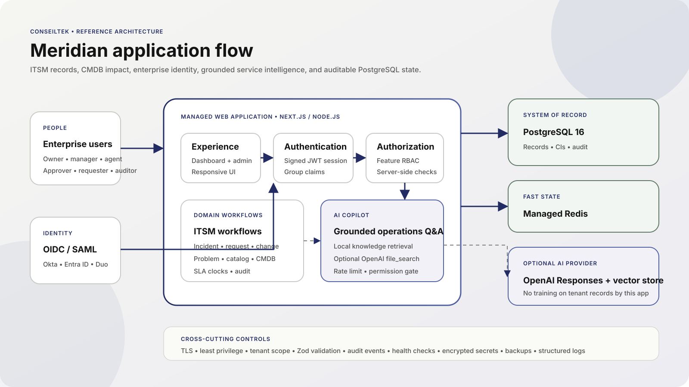

<p align="center"></p>
<h1 align="center">Meridian</h1>
<p align="center"><strong>Enterprise ITSM without the platform tax.</strong></p>

[](https://github.com/ConseilTek-Tektons/meridian/actions/workflows/ci.yml) [](https://github.com/ConseilTek-Tektons/meridian/actions/workflows/codeql.yml) [](LICENSE)

Meridian is a deployable ITSM reference application for incidents, requests, problems, changes, service catalog workflows, SLAs, knowledge, approvals, and a relationship-aware CMDB. See the [product rationale and honest parity matrix](https://conseiltek.com/techtons/meridian).



## Working scope

- PostgreSQL system of record for business services, configuration items, relationships, incidents, changes, and immutable audit events
- Server-authorized `/api/incidents` workflow with validated impact/urgency priority calculation
- Feature RBAC for owners, administrators, service managers, agents, change managers, approvers, requesters, and auditors
- OIDC for Okta, Microsoft Entra ID, and Duo; SAML through Keycloak
- Grounded service Q&A for similar incidents, CMDB impact, SLA risk, and approved knowledge; no record-mutation agent
- Responsive ConseilTek interface aligned with the current website design

## Run locally

```bash
cp .env.example .env.local
docker compose up -d postgres redis keycloak
pnpm install --frozen-lockfile
pnpm db:migrate && pnpm db:seed
pnpm dev
```

## Deploy

- `infra/aws`: App Runner, Aurora PostgreSQL Serverless v2, ElastiCache Serverless, private S3, SQS, Secrets Manager, and CloudWatch
- `infra/azure`: App Service Web App for Containers, PostgreSQL Flexible Server, Azure Managed Redis, Blob Storage, Storage Queue, Key Vault, and Monitor

Meridian is an authenticated server application and is never deployed as an Azure Static Web App or S3 website.

## Documentation

[Architecture](docs/ARCHITECTURE.md) · [Authentication](docs/AUTHENTICATION.md) · [RBAC](docs/RBAC.md) · [AI](docs/AI.md) · [Security](docs/SECURITY.md) · [Operations](docs/OPERATIONS.md)

Meridian is designed, built, and maintained by [ConseilTek](https://conseiltek.com) under Apache 2.0. Contact [support@conseiltek.com](mailto:support@conseiltek.com).
