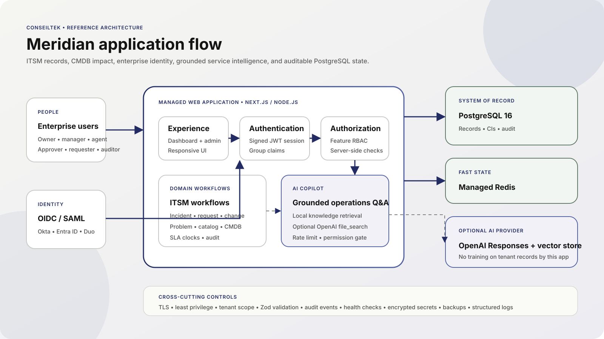
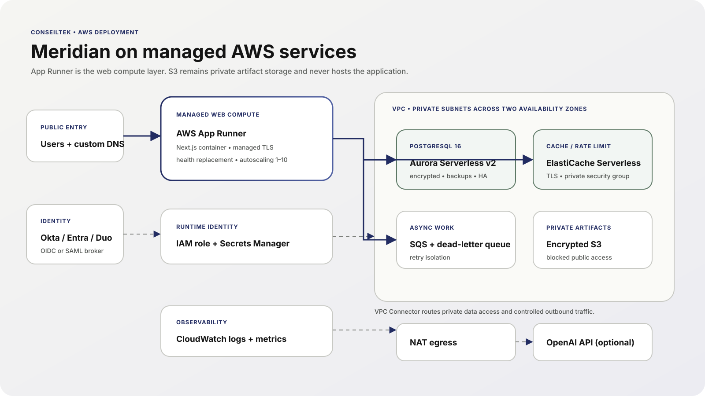
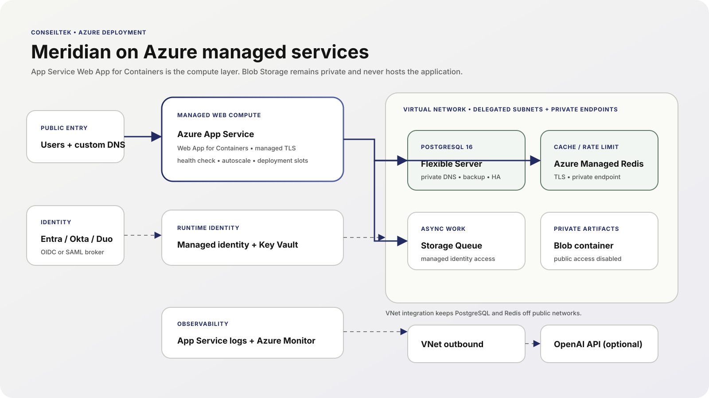

# Meridian architecture

Meridian is a server-rendered Next.js modular application with authenticated APIs, feature RBAC, PostgreSQL 16, optional Redis, and grounded retrieval. The system of record covers incidents, requests, problems, changes, services, CIs, relationships, SLA state, knowledge, approvals, and audit history.

OIDC establishes a signed session; protected routes recheck permissions and tenant scope. Zod validates service records. Incident priority is calculated from impact and urgency, and domain writes append audit evidence. CMDB impact uses bounded relationship traversal and reports truncation rather than running unbounded queries. AI can explain records and retrieve approved knowledge but cannot approve, prioritize, or close them.

AWS uses App Runner with Aurora PostgreSQL Serverless v2, ElastiCache, private object storage, SQS, Secrets Manager, and CloudWatch. Azure uses App Service Web App for Containers with PostgreSQL Flexible Server, Azure Managed Redis, private Blob Storage, Storage Queue, Key Vault, and Monitor.

Both paths use managed web compute and managed PostgreSQL. Static website services are intentionally excluded.
